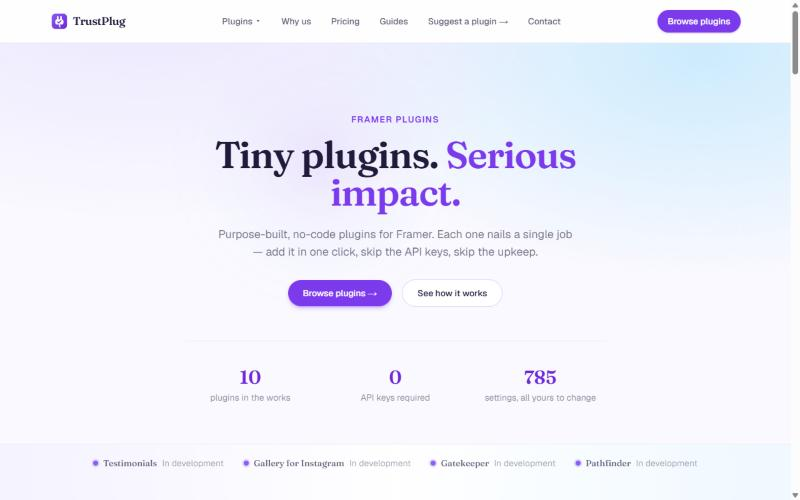
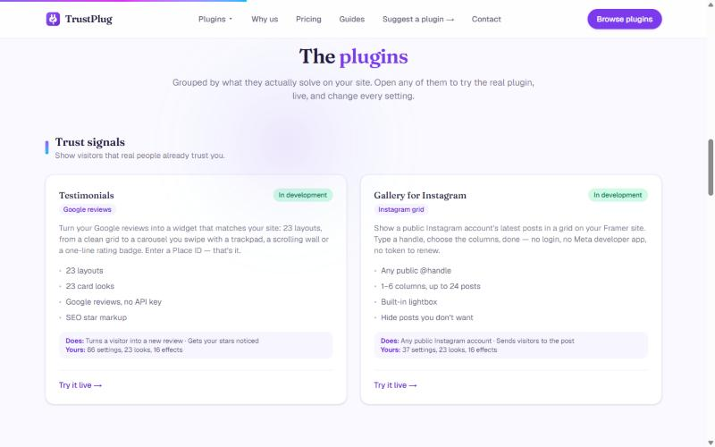
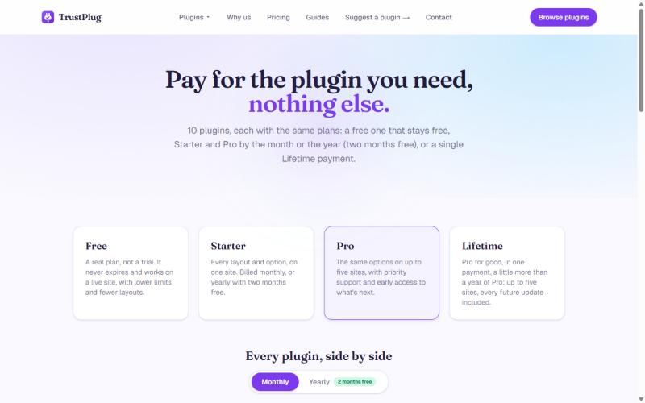

# TrustPlug

**Tiny plugins. Serious impact.** TrustPlug makes purpose-built, no-code plugins for [Framer](https://www.framer.com/). Each plugin nails a single job: add it in one click, skip the API keys, skip the upkeep.

Founded by Valentin Lachaise, engineering student at IMT Atlantique. The plugins are currently in development.

## Links

| | |
|---|---|
| Website | [trustplug.net](https://trustplug.net/) |
| Email | [contact@trustplug.net](mailto:contact@trustplug.net) |
| Instagram | [@trustplug.plugins](https://www.instagram.com/trustplug.plugins/) |
| X (Twitter) | [@_TrustPlug_](https://x.com/_TrustPlug_) |

## The plugins

Ten plugins, grouped by what they solve on a website. All are in development.

| Category | Plugin | What it does |
|---|---|---|
| Trust signals | **Testimonials** | Turns Google reviews into widgets that match the site, with 23 layouts and no API key. |
| Trust signals | **Gallery for Instagram** | Shows the latest posts of any public Instagram account in a grid, with a built-in lightbox. |
| Visitor access & flow | **Gatekeeper** | Allows or blocks visitors by country, and detects VPN and proxy traffic. |
| Visitor access & flow | **Pathfinder** | Redirects visitors by country, language or device, or suggests a page with a banner. |
| Local business | **Landmark** | Embeds an interactive Google Map with directions. |
| Local business | **Open Hours** | Shows whether the business is open, from hours typed in or synced from a calendar or Google listing. |
| Visitor engagement | **Feedback** | Collects ratings, problems and ideas, and sends them to Slack, Discord, Teams or a spreadsheet. |
| Visitor engagement | **FAQ** | A searchable list of questions and answers. |
| Site state | **Standby Mode** | Shows a maintenance page with a countdown while the team still sees the live site. |
| Privacy & consent | **Cookie Consent** | Blocks trackers until a visitor accepts, and deletes refused cookies. |

Why TrustPlug:

- Sensitive credentials stay on TrustPlug's servers, never on the published site.
- Plugins work right after installation; settings are optional.
- Styling adapts to the site's colours, fonts and spacing.
- Every setting can be changed from a panel, without code.

The site also has a [guides](https://trustplug.net/guides) section, with articles on blocking countries and VPN traffic, redirecting visitors by country or language, and adding Google reviews to a Framer site.

## Pricing

Every plugin has the same four plans: **Free** (never expires, with lower limits and fewer layouts), **Starter** (every layout and option, on one site), **Pro** (up to five sites, priority support and early access) and **Lifetime** (Pro paid once, with every future update). Starter and Pro can be billed monthly, or yearly with two months free.

Indicative prices in USD, as shown on the site on 21 October 2026 (they will be confirmed before launch):

| Plugin | Starter | Pro | Lifetime |
|---|---|---|---|
| Testimonials | $5.99/mo | $9/mo | $129 |
| Gallery for Instagram | $7.99/mo | $17.99/mo | $229 |
| Gatekeeper | $6/mo | $10/mo | $129 |
| Pathfinder | $9/mo | $14/mo | $179 |
| Landmark | $3/mo | $5/mo | $69 |
| Open Hours | $5/mo | $8/mo | $109 |
| Feedback | $6/mo | $10/mo | $129 |
| FAQ | $3/mo | $5/mo | $69 |
| Standby Mode | $4/mo | $6/mo | $79 |
| Cookie Consent | $4/mo | $6/mo | $79 |

## What's in the repo

| Path | What it is |
|---|---|
| `index.html` | A self-contained presentation page of TrustPlug and its plugins (plain HTML and CSS, light and dark mode). Open it in a browser. |
| `docs/` | Screenshots of [trustplug.net](https://trustplug.net/) used in this README. |

The product site itself is [trustplug.net](https://trustplug.net/).

## About

&copy; 2026 TrustPlug. Founder: [Valentin Lachaise](https://github.com/Valentin-Lachaise) · [vlachaise.pages.dev](https://vlachaise.pages.dev)
